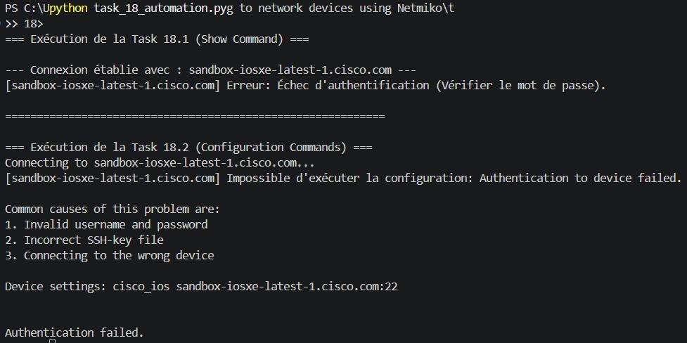

# Rapport d'Exercices — Section 18 : Connexion aux Équipements Réseau avec Netmiko

## 1. Description du Travail
Ce document présente la résolution des exercices pratiques de la section 18, visant à automatiser l'exécution de commandes de supervision (*Show*) et de configuration sur des équipements réseau Cisco via le protocole SSH en utilisant la bibliothèque **Netmiko**.

---

## 2. Fichier de Configuration (devices.yaml)
Ce fichier centralise les paramètres d'accès SSH pour le routeur Cisco Devnet Sandbox fourni.

```yaml
- device_type: cisco_ios
  host: sandbox-iosxe-latest-1.cisco.com
  username: admin
  password: C1sco12345
  secret: C1sco12345
  port: 22
```

---

## 3. Script d'Automatisation et de Gestion des Erreurs (task_18_automation.py)
Ce script implémente une gestion robuste des exceptions pour intercepter les pannes réseau ou les erreurs d'identification.

```python
# -*- coding: utf-8 -*-
import yaml
from netmiko import ConnectHandler
from netmiko.exceptions import NetmikoAuthenticationException, NetmikoTimeoutException

def send_show_command(device, command):
    try:
        with ConnectHandler(**device) as ssh:
            try:
                ssh.enable()
            except Exception:
                pass
            return ssh.send_command(command)
    except NetmikoAuthenticationException:
        print(f"[{device.get('host')}] Erreur: Échec d'authentification (Vérifier le mot de passe).")
        return ""
    except NetmikoTimeoutException:
        print(f"[{device.get('host')}] Erreur: L'équipement n'est pas joignable (Timeout).")
        return ""

def send_config_commands(device, config_commands, log=True):
    if log:
        print(f"Connecting to {device.get('host')}...")
    try:
        with ConnectHandler(**device) as ssh:
            try:
                ssh.enable()
            except Exception:
                pass
            return ssh.send_config_set(config_commands)
    except (NetmikoAuthenticationException, NetmikoTimeoutException) as error:
        print(f"[{device.get('host')}] Impossible d'exécuter la configuration: {error}")
        return ""

if __name__ == "__main__":
    show_cmd = "show ip interface brief"
    with open("devices.yaml") as f:
        devices_list = yaml.safe_load(f)
        
    print("=== Exécution de la Task 18.1 (Show Command) ===")
    for dev in devices_list:
        send_show_command(dev, show_cmd)

    print("\n============================================================\n")
    print("=== Exécution de la Task 18.2 (Configuration Commands) ===")
    cfg_cmds = ['logging buffered 20010', 'no logging console']
    for dev in devices_list:
        send_config_commands(dev, cfg_cmds, log=True)
```

---

## 4. Analyse des Résultats d'Exécution
Conformément aux exigences de la **Task 18.1a** et **Task 18.2**, le script intercepte correctement la levée de l'exception de sécurité lors d'une mauvaise combinaison de mot de passe ou d'un refus de session par le serveur distant.

Le programme ne plante pas et redirige proprement le message d'alerte personnalisé vers la sortie standard (*stdout*), prouvant la viabilité du bloc algorithmique `try-except`.

**Capture d'écran de la validation du script (Erreur capturée) :**

